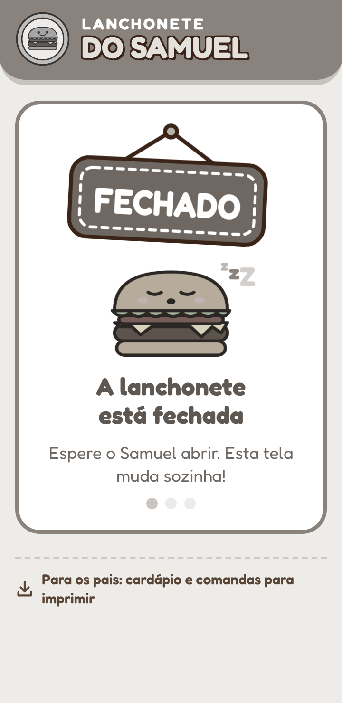
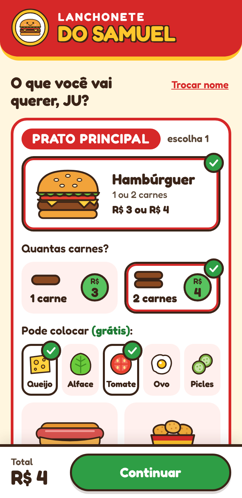
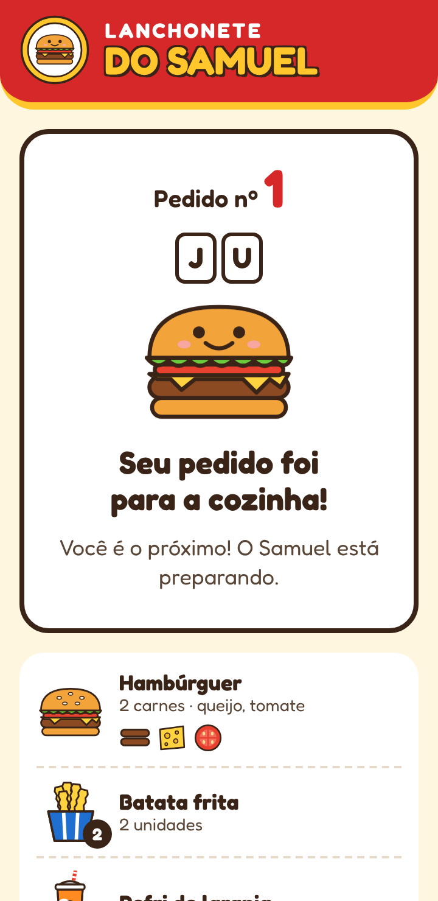
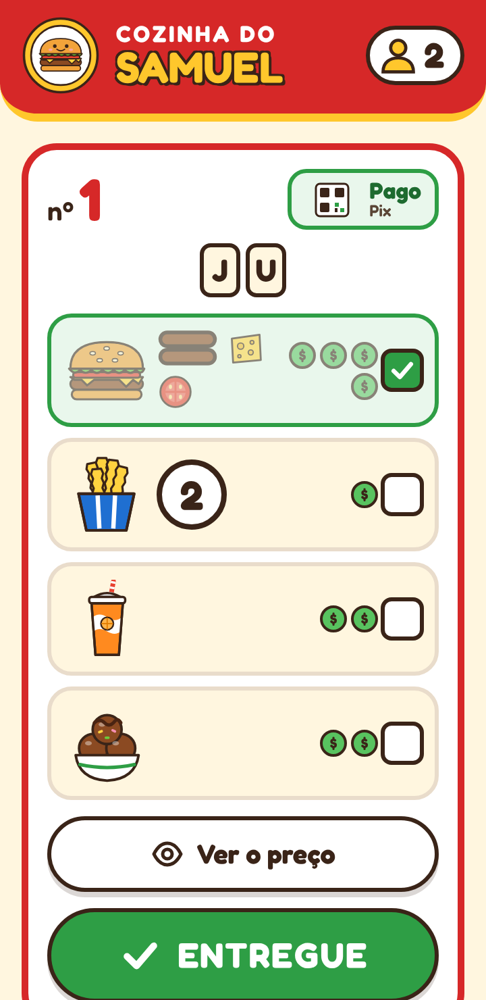
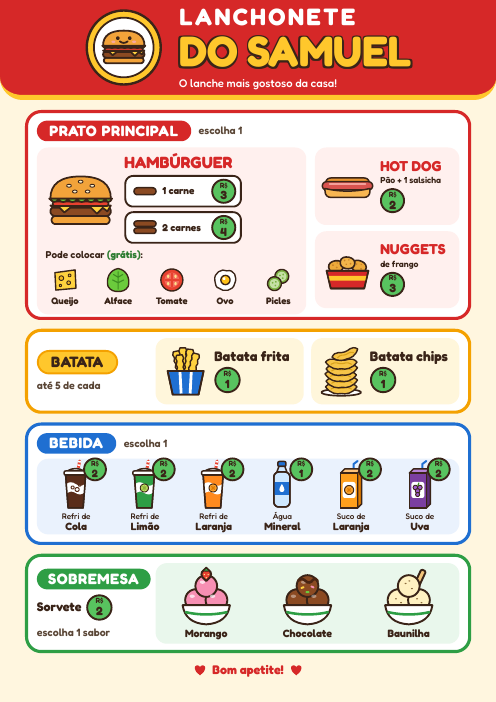
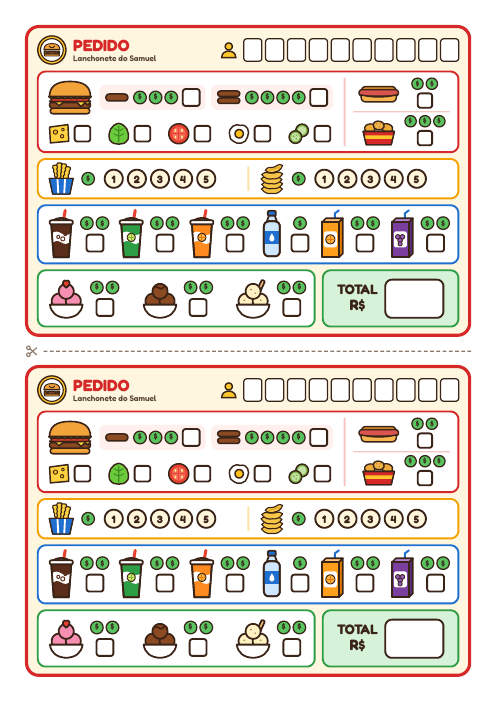
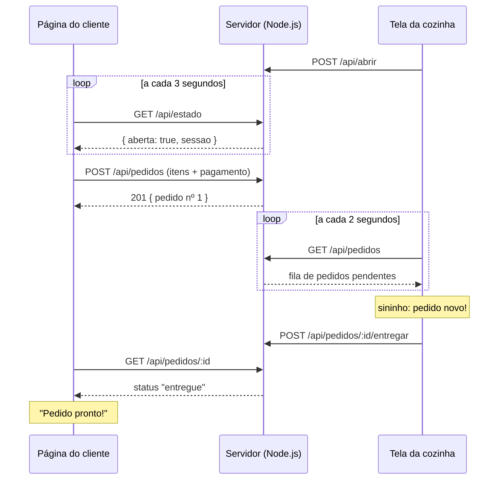

# 🍔 Lanchonete do Samuel

Site para uma brincadeira de **faz de conta de lanchonete**. Os "clientes" fazem pedidos pelo próprio celular e o atendente (uma criança de 5 anos que ainda não lê) vê cada pedido em **desenhos e moedinhas**, prepara com os brinquedos e entrega.

Também é um **projeto educativo**: um sistema cliente-servidor completo, pequeno o bastante para ser lido do começo ao fim, feito com **Node.js puro, HTML, CSS e JavaScript**, sem frameworks e sem nenhuma dependência para instalar. O código é comentado para estudo.

<p align="center">
  
  
  
</p>
<p align="center">
  
  
</p>

---

## Sumário

- [Como a brincadeira funciona](#como-a-brincadeira-funciona)
- [Funcionalidades](#funcionalidades)
- [Tecnologias](#tecnologias)
- [Como o sistema funciona por dentro](#como-o-sistema-funciona-por-dentro)
- [Estrutura de pastas](#estrutura-de-pastas)
- [Como rodar](#como-rodar)
- [Acessar de outros aparelhos](#acessar-de-outros-aparelhos)
- [Personalizar o cardápio](#personalizar-o-cardápio)
- [Conceitos para estudar no código](#conceitos-para-estudar-no-código)
- [Sugestões de atividades](#sugestões-de-atividades)
- [Limitações e segurança](#limitações-e-segurança)
- [Licença](#licença)

---

## Como a brincadeira funciona

1. Um adulto liga o servidor. A lanchonete começa **fechada**: quem abre a página de clientes vê uma tela cinza com a placa "FECHADO".
2. O atendente abre a **tela da cozinha** e toca no botão verde **ABRIR A LANCHONETE**.
3. Cada cliente escreve o nome (ou apelido), escolhe o prato principal, as batatas, a bebida e a sobremesa, e "paga" de brincadeira (dinheiro, cartão ou pix de mentira).
4. Na cozinha toca um sininho. O pedido aparece com desenhos, o nome em quadradinhos e **uma moedinha verde para cada real**: o atendente conta as moedinhas para saber o total e pode tocar em **Ver o preço** para conferir.
5. Ao tocar em **ENTREGUE**, o celular do cliente avisa que o pedido está pronto.
6. No fim, **Fechar a lanchonete** (com a pergunta "Fechar mesmo?") apaga tudo, para a próxima brincadeira começar limpa.

O cardápio e a comanda também existem em papel (PDF A4, na pasta [`public/impressao`](public/impressao)), com os mesmos desenhos, para brincar sem celular:

<p align="center">
  
  
</p>

## Funcionalidades

**Página do cliente** (`/`)
- Tela de "lanchonete fechada" que muda sozinha quando o atendente abre.
- Montagem do pedido com o total atualizado na hora.
- Resumo, pagamento de brincadeira e acompanhamento ("tem 1 pedido antes do seu", "pedido pronto!").
- Link **Para os pais** com o cardápio e as comandas em PDF.

**Tela da cozinha** (`/samuel`)
- Abrir e fechar a lanchonete (fechar pede confirmação e apaga a fila).
- Fila de pedidos em ordem de chegada, só com desenhos.
- Sininho, vibração e alerta com o nome quando chega pedido novo.
- Toque em cada item para marcar como feito; botão para revelar o preço.

**Cardápio:** hambúrguer (1 ou 2 carnes, com queijo, alface, tomate, ovo e picles grátis), hot dog, nuggets, batata frita e batata chips (até 5 de cada), refrigerantes, água, sucos e sorvete. Os preços são inteiros e baixos (o pedido mais caro dá exatamente R$ 10) para a criança somar nos dedos.

## Tecnologias

| Parte | O que foi usado |
| --- | --- |
| Servidor | Node.js 18+ só com módulos nativos (`http`, `fs`, `path`, `os`, `crypto`) |
| Comunicação | API REST simples em JSON, consultada com `fetch` (polling) |
| Páginas | HTML5, CSS3 (variáveis, Flexbox, Grid, animações) e JavaScript puro |
| Desenhos | SVG escrito no código (nenhum arquivo de imagem nas páginas) |
| Som | Web Audio API (as notas são geradas na hora, sem arquivos de áudio) |
| Navegador | `localStorage` para lembrar o pedido se a página recarregar; Vibration API |
| Dados | Só na memória do servidor (sem banco de dados) |

## Como o sistema funciona por dentro

São três partes: o **servidor** (guarda o estado e responde às perguntas), a **página do cliente** e a **tela da cozinha**. As páginas não conversam entre si: as duas perguntam ao servidor de tempos em tempos (*polling*).



### API

| Método | Rota | Para que serve |
| --- | --- | --- |
| `GET` | `/api/estado` | Diz se a lanchonete está aberta e qual é a sessão atual |
| `POST` | `/api/abrir` | Abre a lanchonete (começa do zero) |
| `POST` | `/api/fechar` | Fecha e apaga a fila e os pedidos |
| `GET` | `/api/pedidos` | Fila de pedidos pendentes (tela da cozinha) |
| `POST` | `/api/pedidos` | Cria um pedido; responde `409` se a lanchonete estiver fechada |
| `GET` | `/api/pedidos/:id` | Situação de um pedido e quantos há antes dele |
| `POST` | `/api/pedidos/:id/entregar` | Marca o pedido como entregue |

Exemplo de pedido enviado pelo cliente:

```json
{
  "nome": "JU",
  "lanche": { "tipo": "hamburguer", "carnes": 2, "opcionais": ["queijo", "tomate"] },
  "batatas": { "frita": 2, "chips": 0 },
  "bebida": "laranja",
  "sobremesa": "chocolate",
  "pagamento": "pix"
}
```

O **total é sempre recalculado no servidor**, com a mesma tabela de preços (`public/js/cardapio.js`), e nunca aceito pronto do navegador.

### Sessão: como a página sabe que a lanchonete fechou e reabriu

Cada vez que a lanchonete abre, o servidor cria um código aleatório (a **sessão**). O celular do cliente guarda esse código junto com o nome. Se numa consulta a sessão vier diferente, a lanchonete fechou e abriu de novo entre duas perguntas: o celular apaga o nome e o pedido antigos e começa do zero.

## Estrutura de pastas

```
lanchonete-do-samuel/
├── server.js                # servidor HTTP + API + arquivos estáticos
├── package.json             # só para "npm start" (não há dependências)
├── public/                  # tudo o que o navegador recebe
│   ├── index.html           # página do cliente (todas as telas)
│   ├── samuel.html          # tela da cozinha
│   ├── css/
│   │   ├── estilo.css       # cores, botões e estilos comuns
│   │   ├── cliente.css      # estilos da página do cliente
│   │   └── samuel.css       # estilos da tela da cozinha
│   ├── js/
│   │   ├── cardapio.js      # itens, preços e cálculo (usado também pelo servidor)
│   │   ├── icones.js        # desenhos em SVG
│   │   ├── comum.js         # funções usadas pelas duas páginas
│   │   ├── cliente.js       # lógica da página do cliente
│   │   └── samuel.js        # lógica da tela da cozinha
│   └── impressao/           # cardápio e comandas em PDF (A4)
└── docs/                    # imagens deste README
```

## Como rodar

Pré-requisito: **Node.js 18 ou mais novo**. Não é preciso `npm install`.

```bash
git clone <endereço-deste-repositório>
cd lanchonete-do-samuel
node server.js        # ou: npm start
```

O terminal mostra os endereços:

```
  Clientes:  http://IP-DO-SERVIDOR:8080/
  Samuel:    http://IP-DO-SERVIDOR:8080/samuel
```

Para usar outra porta (por exemplo, se a 8080 já estiver ocupada):

```bash
PORTA=3000 node server.js
```

No Windows (PowerShell): `$env:PORTA=3000; node server.js`

### Rodando num celular Android (Termux)

Um celular antigo pode ser o servidor. No [Termux](https://termux.dev/) (instalado pelo F-Droid):

```bash
pkg install -y nodejs-lts unzip
termux-wake-lock                      # impede o Android de pausar o Termux
cd ~/lanchonete-do-samuel && node server.js
```

Para copiar os arquivos para o celular, descompacte o `.zip` **pelo próprio Termux** (`unzip -o arquivo.zip`), ou envie por SFTP (o Termux tem servidor SSH com `pkg install openssh` e `sshd`, na porta 8022). Alguns gerenciadores de arquivos do Android não extraem todos os arquivos.

## Acessar de outros aparelhos

- Todos os aparelhos precisam estar na **mesma rede Wi-Fi** do servidor.
- Use o IP que o servidor mostra ao ligar (algo como `192.168.x.x`).
- Para o endereço não mudar, reserve um IP fixo para o servidor nas configurações do roteador (DHCP estático).
- No Windows, o Firewall pode perguntar se o Node.js pode receber conexões: permita em **redes privadas**.

### Dica: acesso remoto, fora de casa

A forma mais segura é **não abrir portas no roteador** e usar uma **VPN** entre os seus aparelhos, como [Tailscale](https://tailscale.com/), [ZeroTier](https://www.zerotier.com/) ou um servidor [WireGuard](https://www.wireguard.com/) próprio. Com o aplicativo da VPN instalado no servidor e no celular, o servidor ganha um endereço próprio dentro da VPN, e o site é acessado por ele como se todos estivessem em casa. O servidor já mostra esse endereço junto com os outros quando liga.

Evite publicar o site direto na internet: ele não tem login nem HTTPS (veja [Limitações e segurança](#limitações-e-segurança)).

## Personalizar o cardápio

- **Itens e preços:** edite só [`public/js/cardapio.js`](public/js/cardapio.js). O servidor e as páginas usam esse mesmo arquivo.
- **Desenhos:** ficam em [`public/js/icones.js`](public/js/icones.js), como SVG. Um item novo precisa de um desenho com o mesmo `id`.
- **Cores:** variáveis no começo de [`public/css/estilo.css`](public/css/estilo.css).
- **PDFs:** se mudar itens ou preços, o cardápio e a comanda impressos (`public/impressao`) precisam ser refeitos e trocados.

Depois de mudar arquivos, reinicie o servidor (`Ctrl + C` e `node server.js`) e recarregue as páginas.

## Conceitos para estudar no código

| Conceito | Onde ver |
| --- | --- |
| Servidor HTTP sem framework e roteamento manual | `server.js` → `tratar()` |
| API REST, métodos GET/POST e códigos de status (200, 201, 400, 404, 409) | `server.js` |
| Validar no servidor e não confiar no navegador | `server.js` → `limparNome()`; `cardapio.js` → `calcular()` |
| Proteção contra *path traversal* | `server.js` → `servirArquivo()` |
| Código compartilhado entre navegador e Node.js | `cardapio.js` (IIFE + `module.exports`) |
| Requisições assíncronas com `fetch` e Promises | `comum.js` → `Comum.api()` |
| Polling e estado vindo do servidor | `cliente.js` → `verificarEstado()`, `aplicarEstado()` |
| Aplicação de página única (várias telas num HTML) | `cliente.js` → `mostrarTela()` |
| Delegação de eventos com `data-*` | `cliente.js` (ouvinte de cliques) |
| `localStorage` e retomada após recarregar | `comum.js`, `cliente.js` → `retomar()` |
| Evitar injeção de HTML (XSS) | `comum.js` → `Comum.escapar()` |
| Detectar novidades numa lista | `samuel.js` → `buscar()` |
| Gráficos vetoriais (SVG) gerados por código | `icones.js` |
| Síntese de som no navegador | `comum.js` → `nota()`, `Comum.plim()` |
| Layout responsivo "mobile first" e acessibilidade | `estilo.css`, atributos `aria-*` no HTML |

## Sugestões de atividades

Ideias de exercícios para quem quer praticar com o projeto:

1. **Item novo:** adicione um milk-shake às sobremesas (dado em `cardapio.js` e desenho em `icones.js`).
2. **Tempo de espera:** mostre na cozinha há quantos minutos cada pedido chegou (o campo `criadoEm` já existe).
3. **Histórico:** grave os pedidos entregues num arquivo JSON e crie uma rota `GET /api/historico`.
4. **Tempo real:** troque o polling por *Server-Sent Events* (`text/event-stream`) e compare o número de requisições.
5. **Senha da cozinha:** proteja as rotas de abrir, fechar e entregar com um código simples.
6. **Testes automatizados:** escreva testes para `calcular()` com o executor de testes nativo do Node (`node --test`).
7. **Acessibilidade:** navegue pelas páginas só com o teclado ou com um leitor de tela e anote o que pode melhorar.

## Limitações e segurança

- **Sem login:** qualquer pessoa na mesma rede que souber o endereço `/samuel` pode abrir ou fechar a lanchonete. O projeto foi pensado para rede doméstica.
- **Sem HTTPS:** o tráfego não é criptografado. Para acesso de fora de casa, use uma VPN (veja acima) em vez de abrir portas no roteador.
- **Dados só na memória:** desligar o servidor ou fechar a lanchonete apaga a fila e os pedidos. É de propósito.
- **Fonte:** a fonte Fredoka vem do Google Fonts. Sem internet, o navegador usa uma fonte do próprio sistema e o site continua funcionando.

## Licença

Distribuído sob a licença [MIT](LICENSE). Pode usar, copiar, modificar e compartilhar, inclusive em aulas, mantendo o aviso de licença.

---

Feito com carinho para o Samuel. 🍟
